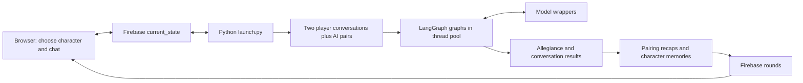

# Current system map

Initial reconnaissance, 2026-10-21. Source baseline: `8247a6776e3ccab6945419ace142531d2cb431a5`.

This is a source-level map, not a claim that the application has been run successfully. No Firebase connection or paid model call was made. Runtime behavior, hosted configuration, and dependency compatibility still need verification.

## Repository and inventory

- The Git repository is the nested `allegiance-and-influence/` directory. Its configured origin is `https://github.com/platypii/allegiance-and-influence.git`.
- Frontend: Next.js 14.2.13, React 18, TypeScript, CSS modules, Firebase browser client. D3 is declared but the graph renderer implements its own forces with React, positioned HTML, SVG lines, and `requestAnimationFrame`.
- Backend: Python, Poetry, LangChain model wrappers, LangGraph conversations, Firebase Admin. There is no separate HTTP application server in the inspected code.
- Content: 23 recruitable characters in JSON; matching frontend copies plus two player records. All 23 character IDs have frontend portraits.
- Art: portraits, room background, splash logo, chat panel textures, send icon, and victory images in `frontend/public/images/`; additional source art under `gameplay/`.
- Approximately 2,702 lines of Python, TypeScript/TSX, and CSS in the application directories. This is small enough to migrate incrementally within one repository.
- A Python lockfile is tracked. No frontend lockfile, test suite, or GitHub Actions workflow was found in the tracked inventory. Local frontend dependencies are not installed.

## Code ownership by responsibility

| Area | Entry points | Responsibility |
| --- | --- | --- |
| Session and round orchestration | `backend/scripts/launch.py` | CLI settings, database reset, participants, selections, conversations, summaries, round progression |
| Conversation scheduling | `backend/htw/graph.py` | Pairing, alternating graph nodes, exits, thread-pool execution |
| Character behavior | `backend/htw/agent/agent.py` | Prompt construction, model invocation, allegiance parsing, memory summaries, human-input waiting |
| Character construction | `backend/htw/agent/builder.py` | JSON loading, seeded character selection, persona prompts |
| Models and prompts | `backend/htw/llm.py`, `backend/htw/config.py` | Anthropic/OpenAI wrappers, prompts, graph limit, model defaults |
| Persistence and communication | `backend/htw/firebase.py` | Shared current state, round history, listeners, database writes |
| Conversation recap | `backend/htw/summarize.py` | Model-generated summaries for each pairing |
| Browser orchestration | `frontend/app/page.tsx` | Database subscriptions, selections, graph data, score, game-over display |
| Board | `frontend/app/forcegraph.tsx` | Animated force layout, portrait nodes, pairing edges, team attraction |
| Conversation interface | `frontend/app/panel.tsx` | Chat input, shared message updates, biography, attributes, end conversation |
| Surrounding interface | `welcome.tsx`, `round.tsx`, `endgame.tsx` | Side selection, round recaps, victory artwork |

`backend/scripts/run.py` is an older CLI path with calls that no longer match current function signatures. Treat it as historical code until tested.

## Current execution flow

1. The launcher connects to a hard-coded Firebase project and credential location, clears the database root, sets up a SQLite response cache, and creates characters.
2. It creates two human participants, or model-driven substitutes with `--all-ai`.
3. Each round replaces shared current state. In human mode the backend waits for both players to select a character. Automated mode selects targets randomly.
4. Selected characters converse with the players. Remaining characters converse in pairs. These conversations execute concurrently, rather than strictly between human turns as the README suggests.
5. A graph alternates two participants until a response indicates joining, an exit marker appears, or graph execution fails/reaches its configured limit.
6. A model's `Status: Join` suffix directly triggers an allegiance change to its opponent's side. Character attributes influence prompts; they are not an explicit numerical rules engine.
7. Player-facing responses stream through read/modify/write operations on Firebase message arrays. Pairing recaps are generated after conversations.
8. The launcher marks conversations complete, then persists each character and generates its next memory summary. It moves on after the shared completion flag is observed.
9. The browser draws team colors and counts from round history; it subscribes to current state for selections and messages.

## Findings that affect migration order

| Finding | Evidence | Consequence |
| --- | --- | --- |
| Startup deletes database root | `launch.py`: `delete_key("/")` | Establish an isolated local environment before executing the launcher |
| One global game | `firebase.py`: `current_state`, `rounds` | Introduce explicit game IDs and scoped storage |
| Pairing ignores shuffle | `graph.py`: shuffles a copy, indexes original | Fix under a regression test; experiment seeds currently do not control pairings as intended |
| Character builder overrides CLI seed | Launcher always supplies `seed=32`; builder seeds global RNG | Use one explicit run configuration and isolated random generator |
| Model choice has competing definitions | Config names Sonnet; launcher hard-codes Opus | Centralize provider/model selection in a recorded run manifest |
| Same target can be chosen twice | UI has no cross-player exclusion; runner reuses mutable agent objects | Define target arbitration before concurrent execution |
| Output text determines allegiance | `has_agent_been_persuaded` parses a suffix | Separate dialogue from validated decisions and authoritative game transitions |
| Round completion precedes persistence/memory | `agents_complete=True` before `increment_round()` | Define and test an atomic completion boundary |
| End condition disagrees with round loop | Browser checks `round_number === 10`; default loop produces 0–9 | Store explicit game completion, winner, and tie state |
| Score includes player nodes | Counts all graph nodes by side | Specify whether displayed score counts only recruits |
| Recaps/scores use previous round | `page.tsx` reads `round_number - 1` | Test last-round results and transition timing explicitly |
| Exceptions can yield partial results | Graph runner catches exceptions and returns accumulated events | Distinguish completed, failed, cancelled, and timed-out work |
| Human waits are unbounded | Polling loops have no overall deadline | Specify disconnect, cancellation, and resume behavior |
| Browser writes shared message arrays | `panel.tsx`, token callback in launcher | Move commands and authoritative state changes behind a validated boundary |
| Character content is duplicated | JSON and TypeScript currently agree | Establish one source and generated or validated consumer data |

The pairing defect was reproduced by extracting only that function with Python's AST module, avoiding application imports and external services: seeds 1, 2, and 3 all produced `(0,1), (2,3), (4,5)`. Character parity and portrait coverage were checked with a local script. Other findings are from source inspection; concurrency and listener behavior need runtime characterization.

## Preserve and investigate

Preserve the existing portraits, visual theme, room background, graph motion, team colors, splash screen, character panel, and victory artwork. Capture browser reference images with fixed layout positions before modifying presentation code. Animation behavior also needs a short recording or explicit interaction checks; a static screenshot cannot prove motion parity.

Remaining discovery: local install/build results; Firebase rules and deployment state; actual streaming behavior; game completion and reconnect flows; asset provenance where redistribution matters; concurrency failure reproduction; exact model-call count, latency, and cost; and the intended distinction between documented and implemented game rules.

The README describes a hexagonal board and five-message interactions. The implementation uses a force-directed graph and a graph recursion limit. Document the observed behavior and separately decide the intended rules.
