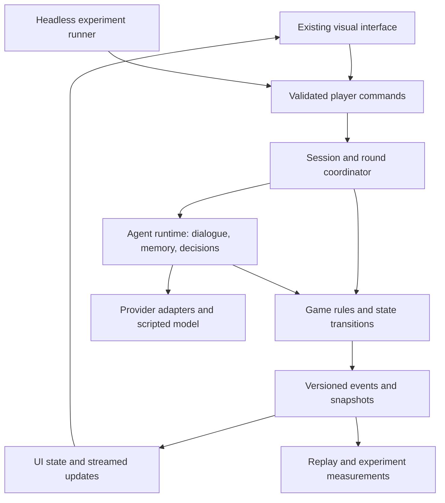

# Allegiance & Influence modernization plan

Roadmap, 2026-10-21. The user authorized autonomous execution. The local foundation is merged in PR #3. The provider-neutral runtime portion of milestone 4 is implemented on `codex/agent-runtime`; live adapters, streaming, and memory remain subsequent work. See `../state/PROJECT_STATE.md` for current evidence and remaining work. See the scoped [runtime task](../work/agent-runtime.md) and [contract](agent-runtime-contract.md) for this increment.

## Scope

- **Audience:** Diego, future development agents, human playtesters, and researchers running agent experiments.
- **Job:** Recover a working baseline, establish the software factory, replace coupled orchestration with a testable game engine and model runtime, then improve gameplay while retaining the visual identity.
- **Success criteria:** After dependency installation, one command starts a complete local demo without cloud services or credentials; two browser clients can play through the local server; saved games survive a server restart; tests exercise rules and failure cases; graphics have reference captures; model/provider choices are configurable; runs have reproducible inputs and replayable outputs; human matches and automated experiments use the same rules; subsequent gameplay changes have playtest evidence.
- **Non-goals for the first milestone:** New art, speculative game mechanics, large-scale hosting, or selecting a permanent model based only on reputation.
- **Format:** Repository documentation and contracts, scoped GitHub tasks, small PRs, an offline verifier, a runnable demo, and an experiment harness.
- **Unknowns:** Intended hosting and repository ownership; primary human-play format; target match length; acceptable inference budget and response latency; which legacy mechanics are intentional. These become decisions before their dependent implementation work.

## Factory approach

Use [Software Factory Starter](https://github.com/doppenhe/software-factory-starter) and its [SPEAR workflow](https://github.com/doppenhe/software-factory-starter/blob/main/skills/spear/SKILL.md): Scope, Plan, Execute, Assess, Resolve. Keep purpose, architecture, and implementation distinct. The user has authorized execution of this roadmap. Track concrete milestone completion and remaining decisions in project state.

Bootstrap only the relevant pieces into this existing repository:

- A concise agent entry document, project scope, plan, current state, decision log, and local runbook.
- One parent modernization epic with milestone tasks. Each implementation task specifies its goal, exact owned paths, inputs, acceptance criteria, dependencies, non-goals, and evidence.
- Small branches and PRs, each completing a demonstrable slice. Separate implementation and review responsibilities when delegated work is authorized.
- Shared contracts shipped as documentation, machine-readable schemas, valid/invalid fixtures, and validators wired into `scripts/agent-verify.sh`.
- One verifier used locally and in CI: deterministic failure proof, relevant Python checks, TypeScript/build checks, contract checks, and browser workflows. Install dependencies separately; default verification makes no paid calls and requires no production credentials.
- Optional live-model evaluations run separately with explicit budgets. Never replace deterministic checks with an LLM's opinion that the change works.
- Cost reporting for development and game inference. Follow the user's polling rule: completion notifications or a single tool-side watcher; if model polling is necessary, only the cheapest available dedicated worker at minimum reasoning.

GitHub bootstrap confirmed write access to the existing origin, `platypii/allegiance-and-influence`. [Epic #1](https://github.com/platypii/allegiance-and-influence/issues/1) tracks modernization; [task #2](https://github.com/platypii/allegiance-and-influence/issues/2) tracks the local foundation.

## Milestones and exit evidence

| Milestone | Goal and approach | Required evidence before moving on |
| --- | --- | --- |
| 1. Recover and map | Finish the system inventory; establish local configuration and a scripted model; run the existing interface against isolated state; record discrepancies and visual references | One complete local match; traced command-to-state flow; asset catalog and screen captures; known failures recorded separately from intended behavior |
| 2. Install the factory | Add the operating documents, issue/PR templates, verification entry point, CI, fixtures, and architecture decisions needed for migration | A fresh agent can run the demo and checks from the documentation; a known-bad fixture fails for the expected reason; CI runs the same checks |
| 3. Extract authoritative game rules | Define session, phase, command, event, character, allegiance, result, and error contracts; implement a pure state-transition core; adapt existing UI to its state view | A scripted full match passes; illegal/duplicate commands are rejected; ties, last-round scoring, target collisions, reconnects, and game isolation are covered; visual parity evidence |
| 4. Modernize agent execution | Add provider adapters, validated decisions, streaming, scoped memory, concurrency limits, timeouts, cancellation, retry policy, and per-run budgets | Same scenario works with fake and live providers; invalid model output cannot corrupt game state; failures terminate or recover predictably; measured latency and cost |
| 5. Restore the experimental test bed | Add headless runs, manifests, replay, policy/model comparisons, trace inspection, and repeated evaluations | Human and headless runs use the same core; a saved run replays without model calls; comparisons include seeds, seat swaps, multiple runs, uncertainty, failures, cost, and latency |
| 6. Iterate on fun | Playtest the migrated baseline; add one small mechanic or pacing change at a time behind scenario/rules configuration | Players can explain their choices and consequences; waiting time and match completion improve; playtest feedback supports keeping each change |

Start a minimal factory record during milestone 1; finish automation once the baseline gives it something real to verify. Model experiments can begin as a thin slice in milestone 4, but broad gameplay redesign follows baseline parity and measurement.

## Proposed architecture

Keep a single repository and a modular application initially. Retain React/Next.js and the existing visual components. Retain Python for the simulation unless discovery supplies a concrete reason to change it. Upgrade dependencies in bounded steps with verification rather than combining every upgrade with the game rewrite.

The core owns legal actions, phase transitions, recruitment outcomes, scoring, and completion. Model output proposes decisions; validation and the rules determine whether they apply. Begin with the current recruitment rule represented explicitly, then change its mechanics in the gameplay phase.

The coordinator owns round scheduling and external work. The agent runtime owns persona, observations, memory, dialogue, and structured proposals. Neither model prose nor a browser write directly mutates authoritative game state.

Prefer a self-contained local server with SQLite persistence and browser connections over HTTP/WebSocket. Keep storage behind a narrow interface and preserve the same game protocol when the server is hosted. This supersedes the initial suggestion to make the Firebase emulator the first compatibility target. An emulator remains an optional legacy-investigation tool if it is needed to characterize old behavior.

## Local operation and multiplayer

The user's preference is to run locally and remove external dependencies where practical. The first implementation follows this design; remaining live-model and hosting capabilities are tracked separately in project state.

- **Application:** Keep the existing React interface and Python game engine. One launcher starts Python, which serves the verified static frontend export and API. The frontend development server is optional for development.
- **Persistence:** SQLite holds game snapshots, accepted events, transcripts, and experiment metadata on the server's local disk. No separate database service is required. Keep transactions short and serialize authoritative changes per game; never hold a database transaction open while awaiting a model.
- **Live interaction:** HTTP handles commands/snapshots and WebSocket delivers state updates; token streaming remains future work. The application owns validation, player/session identity, reconnect handling, event sequence numbers, and duplicate-command protection. The historical Firebase implementation supplied persistence and change notifications; the local service now implements these application behaviors explicitly.
- **Multiplayer:** Two browsers connect to the same local server for testing. An explicit LAN mode allows other devices to connect. Internet play uses the same application on a hosted server, with HTTPS, player authorization, backups, and operational monitoring added before public use. Each match has one authoritative coordinator.
- **Hosting:** Start with one server instance and persistent local storage. SQLite is viable for that topology; multiplayer alone is not a reason to require a cloud database. Multiple server instances and sustained write contention would trigger a separate storage/session-routing design, potentially PostgreSQL. Do not put a SQLite WAL database on a shared network filesystem.
- **Inference:** Scripted policies and replay run offline. Cloud models remain optional adapters requiring network access and credentials. A local-model adapter is a later option for actual offline generative dialogue; hardware and model quality must be measured. Installing dependencies or downloading model weights can still require an initial connection.
- **Firebase:** Remove it from the default runtime. Preserve a clean boundary so a future managed service can be selected for a concrete need. Do not build and maintain a second Firebase implementation speculatively.

Keep the initial dependency footprint to the frontend toolchain, Python application libraries, and embedded SQLite. Avoid mandatory Docker, Redis, a task queue, a Firebase emulator, or a separate database server. Review LangChain/LangGraph separately after the game loop is characterized; retain a framework only where its capabilities earn their maintenance cost.

Local acceptance checks: launch without cloud configuration; complete a two-client match; reconnect and recover the current view; restart and recover committed state with pending work explicitly accounted for; replay a saved match; verify default scripted mode makes no external requests. Loading assets and fonts must also work offline. Session identity must distinguish players even when both tabs are on the same machine.

Technical basis: [SQLite deployment guidance](https://sqlite.org/whentouse.html), [SQLite WAL constraints](https://sqlite.org/wal.html), and [browser WebSocket support](https://developer.mozilla.org/en-US/docs/Web/API/WebSockets_API), checked 2026-10-21. Single-server suitability is a design recommendation to validate under measured game workloads, not a capacity guarantee.

## Migration method

1. Capture the old UI consuming known fixture states, including selection, chat, allegiance changes, round recap, and victory/tie handling.
2. Define a view model compatible with those components. Replace direct Firebase calls with a small client boundary.
3. Move one complete path first: start a game, select a target, converse, resolve recruitment, finish a round, finish a match.
4. Exercise that path with scripted model responses. Record intentional fixes separately from preserved behavior.
5. Add live providers behind the same interface, then automated participants and larger experiments.
6. Remove superseded code only after its behavior has a replacement and relevant evidence.

## Model and experiment design

Choose model candidates from current official provider documentation when implementation begins. Benchmark the actual game tasks: character consistency, persuasion response, decision validity, memory, latency, and cost. Do not hard-code a claimed best model into the architecture.

Route by task where evidence supports it: dialogue, summaries, and evaluation can use different configurations. Give cheap models and scripted policies a fair baseline. Record provider/model IDs, prompt versions, rules version, content version, seed, settings, outputs, failures, token usage, and pricing basis.

Separate three promises:

- Deterministic simulation when supplied the same commands and accepted model outputs.
- Exact playback from recorded events and outputs, with no inference required.
- Repeated live experiments with controlled inputs; a seed does not make a remote model deterministic.

Start with controlled recruitment scenarios and paired games with seat swaps. Compare personality coherence, recruitment and defection patterns, faction spread, validity, completion, latency, and cost. Add topology, memory, and policy variations independently so experiments remain interpretable. Keep game-hidden information out of each agent's observations.

## Gameplay hypotheses to test later

Keep the initial recognizable loop: choose someone, talk, watch influence spread. Observe where that loop lacks meaningful choice before designing a larger game.

Possible small experiments: visible motivations and relationship changes; limited attention or conversation opportunities; promises with consequences; indirect recruitment through allies; and concise explanations of decisive allegiance changes. These are hypotheses, not committed features.

Evaluate fun through human playtests: time to first meaningful choice, time waiting, clarity of consequences, perceived agency, and willingness to play again. Agent win rate alone cannot establish whether the game is enjoyable.

## First work packets

1. **Baseline inventory and behavior specification:** Finish the map, resolve documentation/code discrepancies, inventory assets/configuration/dependencies, and define the match lifecycle.
2. **Self-contained local launch:** Introduce a local server and client boundary, scoped game setup, SQLite persistence, and a scripted model; remove the default Firebase connection and global reset. Acceptance: two browser clients complete a local round without cloud credentials, an emulator, or paid calls. Keep this compatibility slice small; the full rules extraction remains packet 5.
3. **Full-match fixtures and visual references:** Capture representative states; exercise end-of-match and tie behavior; retain art and graph appearance. Acceptance: a repeatable complete demo and reviewed baseline captures.
4. **Verification and coordination bootstrap:** Add the project-specific factory entry points, CI, and task templates. Acceptance: clean setup instructions plus passing checks and a failing-fixture proof.
5. **Core contract and first migrated slice:** Define the shared shapes and implement the lifecycle through the existing UI. Acceptance: full scripted match and tested game invariants.

Do not estimate the full rewrite until packets 1–3 establish the install, runtime, and migration baseline. That is the first useful planning checkpoint.

## Evidence and limits

Repository findings are linked in [current-system-map.md](current-system-map.md). Factory references were fetched from `doppenhe/software-factory-starter` on 2026-10-21; its README, SPEAR, contracts, and verifier guidance informed this proposal.

Local HypAware message search covered 2026-09-01 through 2026-10-21. A September 8 recorded session (`01a082b5-8536-72d1-9b38-9d40ad775005`) pointed to that starter; this was a bounded local search, not a complete cross-machine workflow audit. The source template was then read directly. Recorded content was used as evidence, not adopted as new personal instructions.
